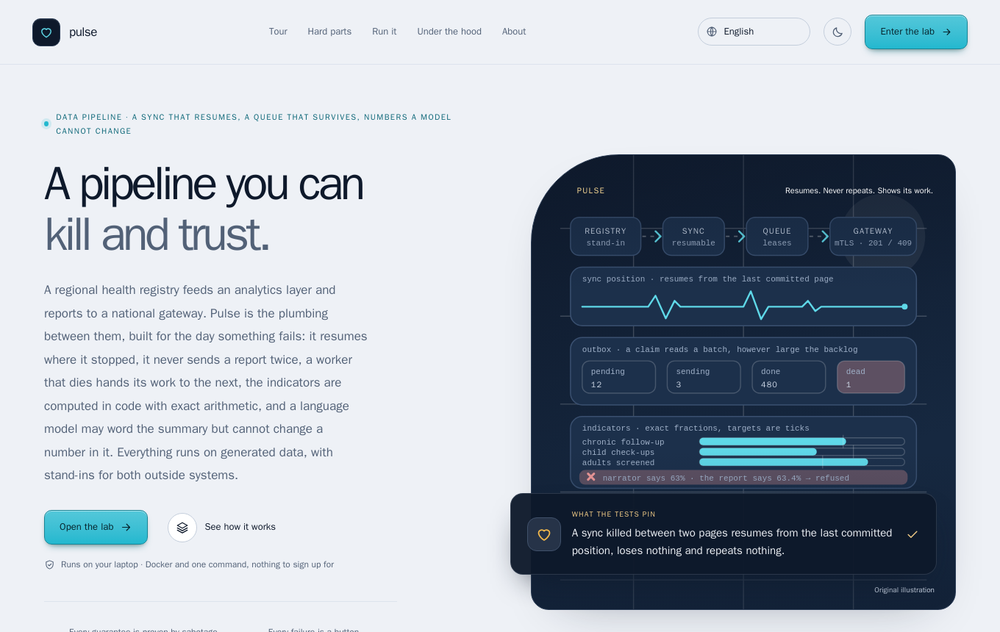
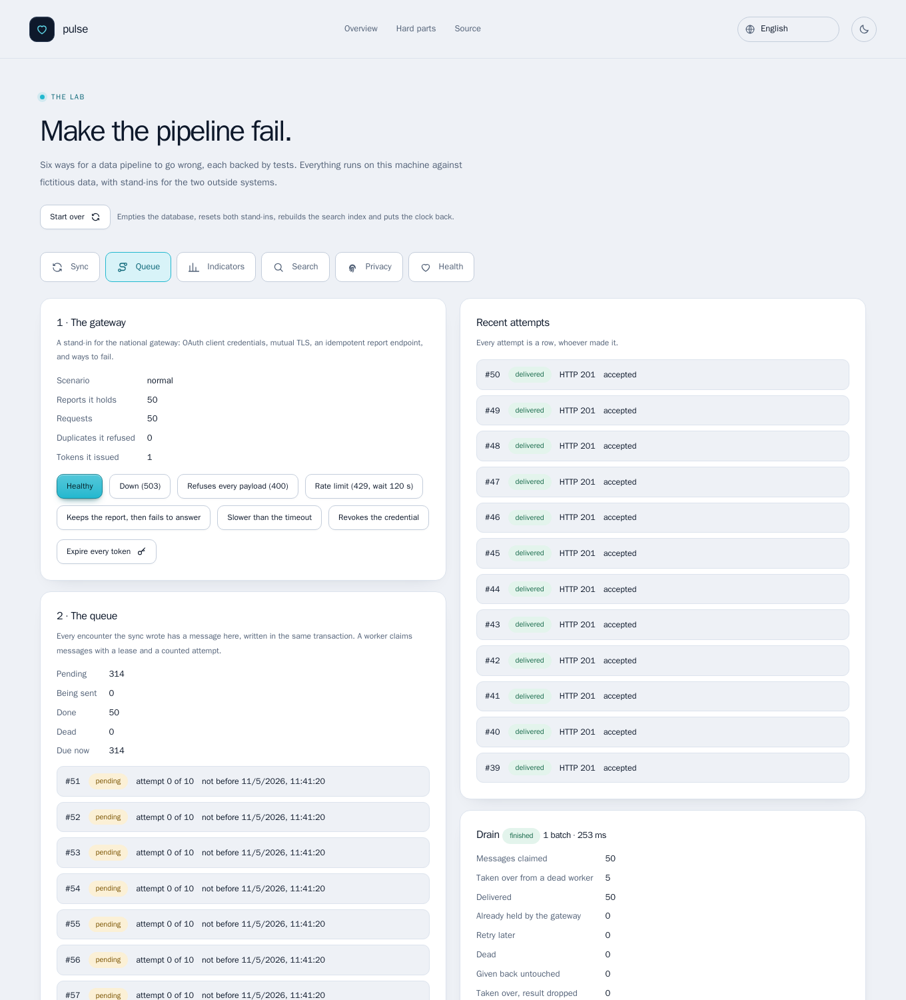
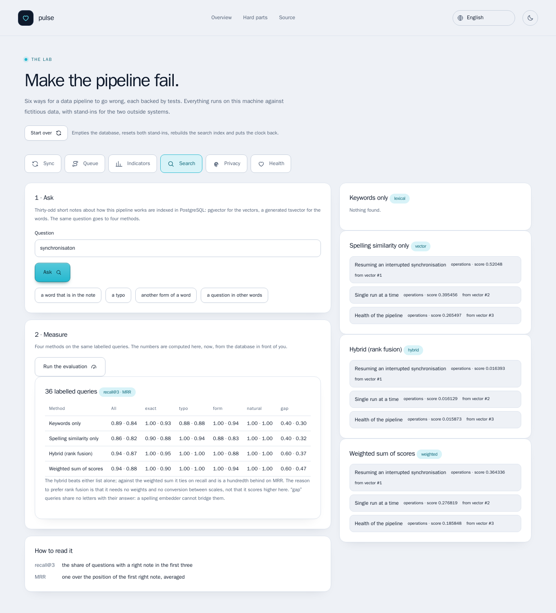
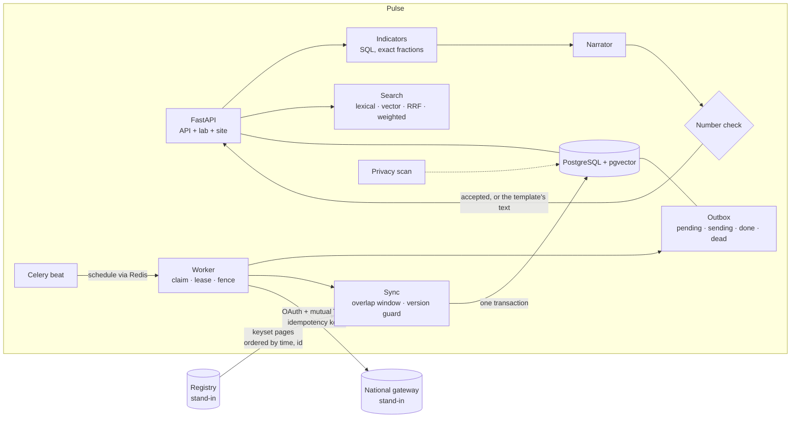
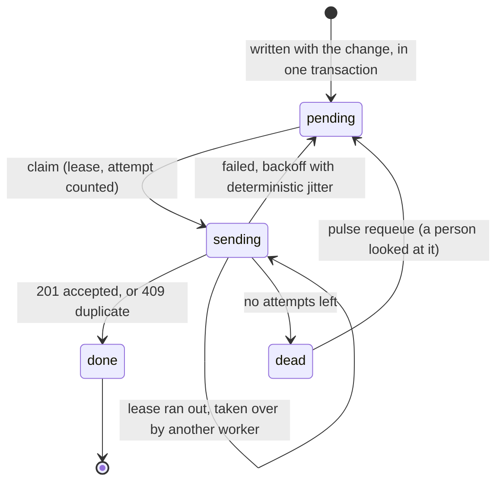
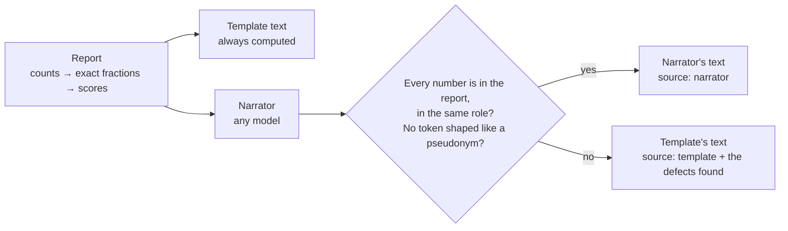

# pulse-health-pipeline

> A data pipeline you can kill and trust. A sync that **resumes** where it stopped, a queue that **survives** a dead
> worker, indicators computed with **exact arithmetic**, and a language model that may word the summary but
> **cannot change a number** in it.

[](https://github.com/MenoDK/pulse-health-pipeline/actions/workflows/ci.yml)




The landing page is available in **14 languages** (English, 中文, हिन्दी, Español, Français, العربية, বাংলা, Português, Русский, اردو, Bahasa Indonesia, Deutsch, 日本語, 한국어), including right-to-left layouts: open `/?lang=ja` or use the selector in the header. The lab, the decision records and this README stay in English. The translations are machine-quality text written for this project, and a native review is welcome, especially for Hindi, Bengali, Urdu and Arabic.

## Run it in a minute

You need **Docker** (Compose v2) and `make`. No API keys, no accounts, and nothing leaves your machine.

```bash
git clone https://github.com/MenoDK/pulse-health-pipeline.git
cd pulse-health-pipeline
make demo            # builds one image and starts seven containers, waiting until they are healthy
```

Open **http://localhost:8300**. The page explains the project and links to the **lab**, where every hard part below can
be tried in a browser. The lab has no sign-in: it is a local tool, it answers only to `localhost`, and the service refuses to
start with it on outside a development environment ([ADR 0007](docs/adr/0007-a-lab-without-a-login-that-cannot-reach-production.md)).

Port 8300 busy? `API_PORT=8080 make demo`. Stop with `make down`; `make reset` also deletes the database volume.
No `make`? `LAB_MODE=true SITE_DIR=/app/site STANDIN_AS_OF=$(date +%F) docker compose up --build --wait --detach` does the same.
The stack is published on loopback only. `/api/health` reads **degraded** until the first sync has run, which is the
correct answer for a pipeline that has not synchronised anything yet.



*Above: "Crash a worker", then "+10 minutes" and "Drain now". Five messages were abandoned by a worker that no longer
exists; the drain card says* Taken over from a dead worker: 5 *and every message was delivered once.*

## What to try

Each row is a claim that is easy to make and hard to get right. The lab has a **Start over** button between attempts.

| Try to… | In the lab | You should see |
|---|---|---|
| **Lose a record** | Sync → *A week of work*, *Sync*. Then *A record arrives 2 minutes late*, *Sync*. Then *A record arrives 1 hour late*, *Sync*, *Full re-read*. | The 2-minute record is inside the overlap window and is written. The 1-hour one is not: the second sync writes nothing and the full re-read finds it. That is the limit of an overlap window, stated rather than hidden. |
| **Kill a worker** | Sync → *Sync*. Queue → *Crash a worker*, then *+10 minutes*, *Drain now*. | Five messages sit in `sending`, held by a worker that no longer exists, until the lease runs out. Then they are claimed first and the card says `Taken over from a dead worker: 5`. |
| **Slow the gateway** | Queue → *Slower than the timeout*, *Drain now*. | After three transport failures in a row the worker stops and gives the rest of the batch back, with the attempt the claim spent refunded. Not fifty timeouts and fifty spent attempts. |
| **Lose an acknowledgement** | Queue → *Keeps the report, then fails to answer*, *Drain everything due*. Then *Healthy*, *+1 hour*, *Drain everything due*. | The gateway stored every report but answered with an error. The second drain sends them again with the same idempotency key, gets "duplicate", and counts that as delivered. The gateway holds each report exactly once. |
| **Let a model change a number** | Indicators → *Rounds a percentage*, *Invents a forecast*, *Names a person*. | Each is refused and replaced by the template's text, and the response names the defect. |
| **Search for the idea** | Search → *a typo*, *a question in other words*, *Run the evaluation*. | A typo is found by the vector side and missed by the keyword side. The `gap` column (no letters in common with the answer) is the lowest in every row. |
| **Knock without a certificate** | Queue → *Connect with the certificate*, then *Connect without it*. | The gateway answers with the certificate. Without it the handshake is refused and the card names the error. Mutual TLS fails before any HTTP. |
| **Look for a person** | Sync → *Sync*. Privacy → *Search the whole database*. | 120 values (names, identifiers, registry ids of 40 people) looked for in 32 columns, found in none. |



Prefer the terminal? The CLI is in the image, and there is a black-box check that talks to the running stack:

```bash
docker compose exec api pulse search "advisory lock" --mode hybrid -k 3   # lexical | vector | hybrid | weighted
docker compose exec api pulse eval                                        # the 36-query evaluation, four methods
make smoke                                                                # 50 checks through the HTTP API
curl -s localhost:8300/api/health                                         # per component, and how they add up
```

### Run the checks

```bash
make install && make check     # ruff, mypy --strict, 281 tests that need no service, and the landing-page figures check
make test-integration          # starts PostgreSQL+pgvector and Redis on loopback and runs all 550 tests against them
make mutate                    # 158 deliberate breaks of the code; every one must turn a test red
make e2e                       # 65 Playwright tests, an accessibility scan of every page in both themes, against the real stack
make transcripts-check         # the landing page's sample output is what the code prints today
make eval                      # print the search evaluation from the real database
```

## What it is

The plumbing between a registry and an analytics layer, for the day something fails. A regional health registry (a
stand-in in this repository) is read incrementally; each change and the message that reports it are written in one
transaction; a worker sends the messages to a national gateway (another stand-in) over OAuth and mutual TLS; five
indicators are counted in SQL and worded by a narrator whose numbers are checked; notes about the system are searchable
by keyword, by vector and by both. Everything runs on generated data.

**What it is not:** a health product, or a claim about real data. Both outside systems are stand-ins that live here,
every person is generated, and nothing in this repository has been connected to a real registry or gateway. The shapes
(a resumable sync, an outbox, a lease, a check on what a model says) are what it demonstrates. See
[Limitations](#limitations-and-what-i-deliberately-left-out).

---

## Architecture



### One report, a dead worker, and a lost answer

```mermaid
sequenceDiagram
    autonumber
    participant A as Worker A
    participant Q as outbox (PostgreSQL)
    participant B as Worker B
    participant G as Gateway

    A->>Q: claim 50 (SKIP LOCKED, lease, attempts + 1)
    A->>G: report (Idempotency-Key)
    Note over A: A dies before it records anything
    Note over Q: the lease runs out; the messages are still "sending"
    B->>Q: claim (expired leases first, then pending)
    Q-->>B: the same messages, flagged taken_over
    B->>G: report (same key)
    G-->>B: 409 duplicate (it already held it)
    B->>Q: finish ... WHERE locked_by = B  → done
    A-->>Q: finish ... WHERE locked_by = A  → 0 rows (fenced out)
```

### What a message goes through



### What stands between a model and a number



---

## Design decisions

Each has a decision record with the alternatives that lost.

| Decision | Why | Where |
|---|---|---|
| **The queue lives in PostgreSQL** (a transactional outbox) | The message must be written in the same transaction as the change that caused it, and a separate broker cannot join that transaction. Redis only carries the schedule. The cost is polling and a throughput ceiling a broker would not have. | [`exchange/queue.py`](src/pulse/exchange/queue.py) · [ADR 0002](docs/adr/0002-a-queue-with-leases-and-fencing.md) |
| **Leases and fencing** | A claim takes a lease with `FOR UPDATE SKIP LOCKED`. Every result a worker records names it (`locked_by`), so a worker whose lease was taken over cannot overwrite the one that took over. | `queue.py` · ADR 0002 |
| **Attempts are counted at claim time** | A message that kills its worker every time still ends in `dead` instead of looping for ever. | `queue.py` |
| **Stop after three transport failures in a row** | Fifty timeouts against an unreachable gateway would outlast the lease and spend fifty attempts in one cycle. The rest of the batch is handed back with its attempt refunded. | [`exchange/worker.py`](src/pulse/exchange/worker.py) |
| **An overlap window and a version guard** | A record can be committed in the source after one with a later timestamp. The next sync starts a few minutes before the stored time; the guard makes the re-read free because an older copy never overwrites a newer one. | [`sync.py`](src/pulse/sync.py) · [ADR 0003](docs/adr/0003-an-overlap-window-and-a-version-guard.md) |
| **Only a timestamp is stored as the position** | The registry's own record id is not kept anywhere. The position never moves backwards (`_advance`). | `sync.py` · [ADR 0006](docs/adr/0006-pseudonymise-and-keep-only-what-the-indicators-need.md) |
| **Two short queries instead of one with an `OR`** | One query over "expired lease or pending" was measured reading and sorting every due row to return 50. Two index-ordered queries stop at the batch. A test asserts the plan on 200 000 rows. | [ADR 0008](docs/adr/0008-two-short-queries-instead-of-one-with-an-or.md) · `test_schema.py` |
| **Exact fractions, one snapshot** | Five indicators are counted in SQL from a single `REPEATABLE READ` snapshot and scored with `Fraction`: no float between the counts and the score. | [`indicators/`](src/pulse/indicators) |
| **A check between the model and the number** | Every number in the narrator's text must be one the report contains, in the same role (a percentage must be one of the report's percentages). A failure is replaced by the template's text and the response says why. | [`indicators/narrative.py`](src/pulse/indicators/narrative.py) · [ADR 0005](docs/adr/0005-a-check-between-the-model-and-the-number.md) |
| **Rank fusion, not a weighted sum** | It needs no weights and no scale conversion. The evaluation shows it ties the weighted sum on recall and is a hundredth behind on MRR; that is why it is *chosen*, not why it is *better*. | [`search/fusion.py`](src/pulse/search/fusion.py) · [ADR 0004](docs/adr/0004-rank-fusion-over-a-weighted-sum.md) |
| **Pseudonymise, then prove it** | A person is HMAC-SHA256 of the registry id (130 bits, tagged with the key id), a birth month and a team. A scan walks every text, JSON and character column of every table for the real values, reports how many columns it read, and a test plants a value to show it can see one. | [`privacy.py`](src/pulse/privacy.py) · ADR 0006 |
| **A lab without a login that cannot reach production** | The lab answers only to `localhost`, refuses a request whose `Host` or `Origin` it does not own, and the configuration guard refuses `LAB_MODE`, the demo key and the stand-ins outside development. | [`api/security.py`](src/pulse/api/security.py) · [ADR 0007](docs/adr/0007-a-lab-without-a-login-that-cannot-reach-production.md) |
| **Mutual TLS, certificates made at start** | The gateway rejects a client without a certificate at the handshake. The certificates are generated when the stack starts and never committed. | [`standin/devcerts.py`](src/pulse/standin/devcerts.py) |
| **Every guarantee is proven by sabotage** | A script breaks the code one decision at a time (158 breaks); a break that no test notices is a hole in the tests. It found several; see below. | [`scripts/sabotage.py`](scripts/sabotage.py) |

## What the evaluation shows

Thirty-six labelled queries, five kinds, four methods, computed from the database in front of you (`pulse eval`, or the
lab's Search tab). Recall at 3 and mean reciprocal rank:

| Method | All | exact | typo | form | natural | **gap** |
|---|---|---|---|---|---|---|
| Keywords only | 0.89 · 0.84 | 1.00 · 0.93 | 0.88 · 0.88 | 1.00 · 0.94 | 1.00 · 1.00 | **0.40 · 0.30** |
| Spelling similarity only | 0.86 · 0.82 | 0.90 · 0.88 | 1.00 · 0.94 | 0.88 · 0.83 | 1.00 · 1.00 | **0.40 · 0.32** |
| Hybrid (rank fusion) | 0.94 · 0.87 | 1.00 · 0.95 | 1.00 · 1.00 | 1.00 · 0.88 | 1.00 · 1.00 | **0.60 · 0.37** |
| Weighted sum of scores | 0.94 · 0.88 | 1.00 · 0.90 | 1.00 · 1.00 | 1.00 · 0.94 | 1.00 · 1.00 | **0.60 · 0.47** |

How to read it, honestly: the hybrid beats either list alone and only **ties** the weighted sum (a hundredth behind on MRR,
one query moving one place). The `gap` queries share no letters with their answer, and every method is weak on them:
the embedder matches spelling, not meaning. The numbers are printed by `pulse eval`, pinned by a test, and the
landing page's figure for them is checked by `scripts/check_numbers.py`.

## Technical resources demonstrated

| Area | What is in the code | Verified by |
|---|---|---|
| Incremental sync | Keyset paging on `(updated_at, id)`, overlap window, version guard, an advisory lock so two runs cannot race, a position that never moves backwards, a failed run that reports its kind of failure and quotes nothing | `test_sync.py`, `test_records.py`, `test_registry_client.py` |
| Transactional outbox | Enqueue in the caller's transaction, leases, `SKIP LOCKED`, fencing, taken-over detection, requeue, backoff with deterministic jitter | `test_queue.py`, `test_worker.py`, `test_backoff.py`, `test_schema.py` (the plan on 200 000 rows) |
| Delivery | OAuth client credentials with token reuse, mutual TLS, idempotency key, the stop rule | `test_gateway.py`, `test_mtls.py`, `test_standin_gateway.py` |
| Indicators | Counts in SQL under one snapshot, exact scoring with a band per indicator, five indicators | `test_indicators_sql.py`, `test_scoring.py`, a plain-Python reference (`tests/reference.py`) and Hypothesis |
| Narrator check | Role-aware number check, pseudonym-shaped tokens refused, template fallback | `test_narrative.py` |
| Search | PostgreSQL with pgvector and a generated `tsvector`, a hashed trigram embedder, rank fusion and weighted fusion, the labelled evaluation | `test_embedding.py`, `test_fusion.py`, `test_search.py` |
| Privacy | Keyed pseudonyms, identifier check digits, birth month only, the whole-database scan | `test_privacy.py`, `test_identifiers.py`, the lab's Privacy tab |
| Operations | Health per component with a rule for the whole, Celery beat and worker, a production configuration guard | `test_health.py`, `test_tasks.py`, `test_config.py` |
| API | FastAPI, API-key auth outside the lab, security headers and a strict CSP, no docs or schema unless the lab is on, Host and Origin gates | `test_api.py` |
| Verification | 550 tests against a real PostgreSQL, a real Redis and real HTTP servers; 158 sabotages; 50 black-box checks; 65 browser tests with axe in both themes and 14 languages | CI |
| Delivery | Multi-stage Dockerfile (non-root, read-only root filesystem, dropped capabilities), Compose with health checks, pinned and checksum-verified gitleaks, actionlint and hadolint | CI `stack` and `security` jobs |
| Front end | A landing page and a lab in plain JavaScript and CSS: no build step, no framework, nothing from another origin, light and dark themes, reduced motion | `e2e/` |
| Internationalisation | The landing page in 14 languages from per-language tables with English fallback, two right-to-left | `e2e/tests/i18n.spec.ts` |

### What the verification caught while this was built (kept as regression tests)

- **A queue tape claimed a repeat that never happened.** The recorded output on the landing page said a duplicate had been
  refused when the run had none. The recorder now asserts what each caption claims.
- **Behaviour that no test pinned**, found by the sabotage script surviving: the stored position moving backwards when the
  registry had lost its newest records; every claimed message being flagged as taken over instead of only those taken
  from a dead worker; the lab's privacy proof showing a person the pipeline had refused; a stand-in that ignored the date
  it was asked to be up to date to. Each now has a test that was seen failing first.
- **The lab's script had a syntax error** (one missing parenthesis) that no unit test could see. Only a browser did. CI now
  syntax-checks every script of the site.
- **The worker and the scheduler showed as unhealthy** under `docker compose up --wait`, because the image's own health check
  asks the API's port. A first fix for the scheduler (watching its schedule file) failed 15 minutes into a healthy run, because that
  file is not rewritten while it runs. Giving it no check at all passed on the developer's Compose and failed on the CI runner's
  newer one (`has no healthcheck configured` under `up --wait`). The scheduler now checks that it can reach its broker; that it
  is scheduling is what the heartbeat it makes the worker write is for, and `/api/health` reports it.
- **The first picture of the landing page had the status card on top of the artwork.** No test sees that; looking at the
  screenshot did. The artwork was redrawn to leave the room the page's overlays need.
- **An unexplained `ReadError`.** After the lab's "Connect without it" (a rejected TLS handshake), the *next* call down the
  pooled, authenticated connection to the gateway fails once. A keep-alive race was the first suspect and was disproved
  (the servers hold idle connections for 30 s, the client drops them after 5 s, and it still happened). The cause was not
  found. The lab repeats its own control calls once, which is safe because they are idempotent, and a test pins that; the
  pipeline itself is not affected, because its retry rules already treat a transport error as a failed attempt.

---

## Project layout

```
src/pulse/
├── api/            # FastAPI: routes, security (Host/Origin gates, CSP), the lab's routes
├── exchange/       # the outbox queue, the worker's drain, the gateway client (OAuth + mutual TLS), backoff
├── indicators/     # SQL counts, exact scoring, the narrator interface, the number check
├── search/         # corpus, hashed trigram embedder, rank and weighted fusion, the evaluation
├── standin/        # the registry and the national gateway as small servers, and the certificate generator
├── sync.py         # the incremental synchronisation
├── privacy.py      # pseudonyms and the whole-database scan
├── health.py       # per-component health and how it adds up
├── tasks.py        # Celery beat schedule and tasks
├── config.py       # typed settings and the production guard
└── cli.py          # pulse migrate | index | sync | drain | requeue | indicators | search | eval
alembic/            # migrations, round-tripped in a test
tests/              # 550 tests (281 need no service, 269 use PostgreSQL and Redis)
site/               # landing page and lab (plain JS and CSS, served by the API when SITE_DIR is set), site/i18n for the 14 languages
e2e/                # Playwright + axe, run by `make e2e` against the real stack
scripts/            # sabotage.py (mutation testing), smoke.sh, record_transcripts.py, check_numbers.py
docs/               # map (00-READ-FIRST), checklist, handoff and the decision records in adr/
CLAUDE.md           # entry point for an AI coding session (AGENTS.md is the tool-neutral contract)
```

## Configuration

Everything is environment-driven; see [`.env.example`](.env.example) (every value is a placeholder). `make demo` needs no
file: `docker-compose.yml` carries the same defaults. Outside development (`APP_ENV` anything but `development`, `dev`,
`local` or `test`) the service **refuses to start** with the demonstration API key, the demonstration pseudonymisation key,
the lab, or the stand-in control endpoints. Highlights: `DATABASE_URL`, `REDIS_URL`, `API_KEY` (24 characters or more),
`PSEUDONYM_KEY` (32 or more) and `PSEUDONYM_KEY_ID`, `REGISTRY_URL`, `GATEWAY_URL` with `GATEWAY_CA_FILE`,
`GATEWAY_CERT_FILE`, `GATEWAY_KEY_FILE`, `QUEUE_MAX_ATTEMPTS`, `QUEUE_LEASE_SECONDS`.

## Limitations and what I deliberately left out

- **Both outside systems are stand-ins, and every person is generated.** The shapes are realistic; the data and the numbers
  are not, and the indicator targets and the search weights are illustrative.
- **The embedder matches spelling, not meaning.** A paraphrase can miss, and the `gap` row of the evaluation says so. The
  fix is a sentence model behind the same interface; it is not here.
- **The number check does not see numbers spelled out in words** ("sixty-three"). That limit is written down in ADR 0005.
- **The overlap window is a window.** A record that reaches the source later than that is missed by every normal sync and
  found by `pulse sync --full`. There is no reconciliation count against the registry to notice it.
- **No record linkage between people.** If the registry re-issues an id, the same person becomes two pseudonyms.
- **No re-keying tool.** Each pseudonym carries the id of its key, so a rotation can find the rows, but the job is not here.
  The registry's own record id is not stored, so nothing can answer "who is this pseudonym?". That is intended.
- **A long outage can dead-letter messages.** They end in `dead` on purpose, a state a person looks at; `pulse requeue`
  gives them another full set of attempts. The stop rule counts only transport failures, not an error answer.
- **No backup or restore.** The repository leaves that to the platform it runs on.
- **The lab is single-user and has no login.** That is what makes it a local tool, and the reason it is refused in production.
- **The translations are machine quality.** See the note at the top.
- **`/api/docs` and the schema exist only while the lab is on.** Outside it the service publishes neither.

## Working with an AI coding session

The repository carries the documentation system a session needs to be cheap and controllable: a short `CLAUDE.md`, a
tool-neutral `AGENTS.md`, a docs **map** (`docs/00-READ-FIRST.md`) that says which document to open when, a handoff that
lets a fresh session resume from disk, and decision records with their rejected alternatives. It is designed to be checked
by [`docsguard`](https://github.com/MenoDK/docsguard) (`docsguard check`): the map must be complete, the ADRs well formed,
the handoff must carry a measured suite state. `.claude/settings.json` wires `docsguard`'s hooks (destructive git commands
and writes to secrets are refused) and does nothing when it is not installed.

## License

MIT — see [LICENSE](LICENSE).
